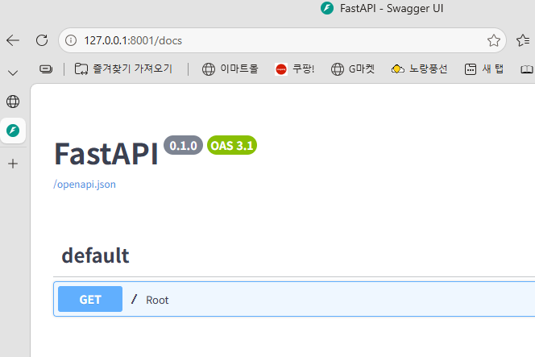
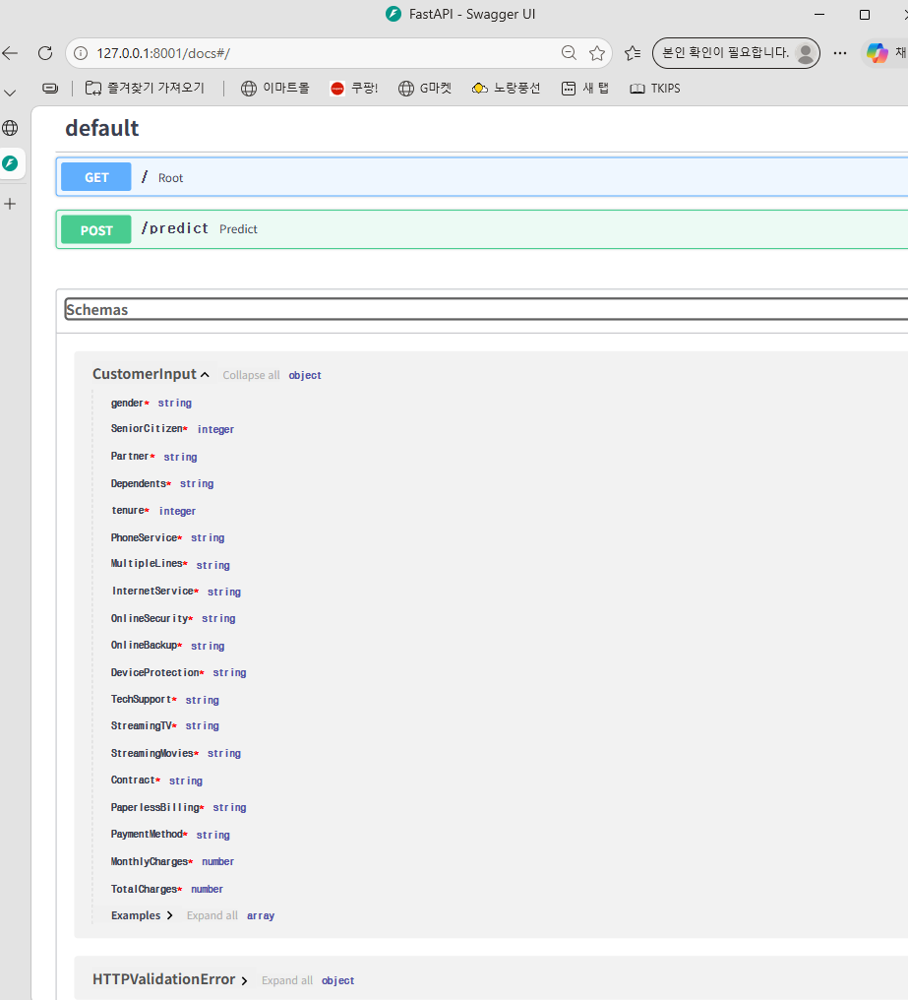
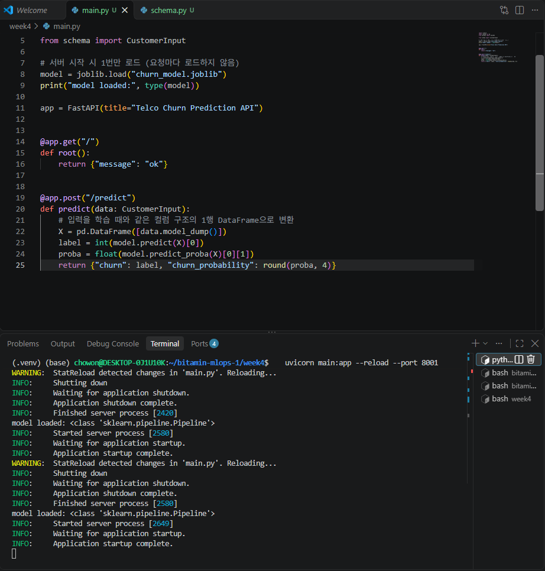
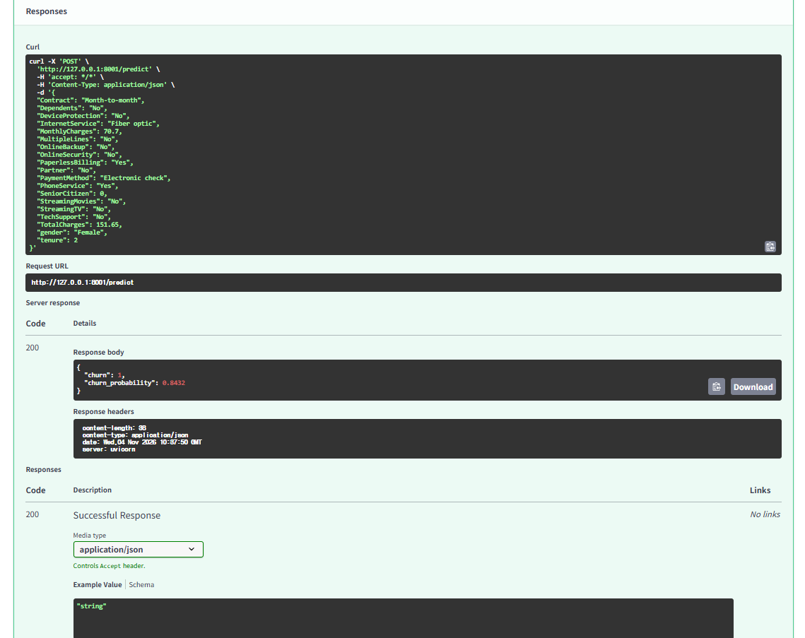
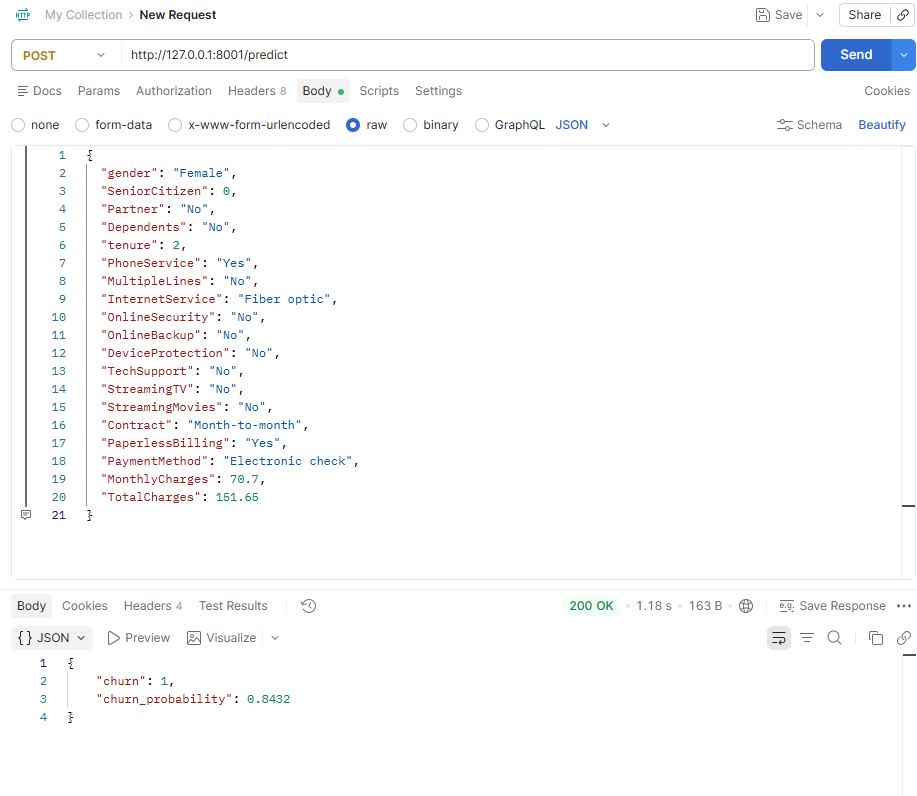

# Week 4 — FastAPI 모델 서빙

> 작성자: 문초원 (1조)

3주차 best model(`churn_model.joblib`, sklearn Pipeline)을 FastAPI로 감싸 HTTP로 호출 가능한 이탈 예측 API를 만든다.

## 실행 방법

```bash
cd week4
python -m venv .venv
source .venv/bin/activate          # Windows PowerShell: .venv\Scripts\Activate.ps1
pip install -r requirements.txt
uvicorn main:app --reload --port 8001
```

- Swagger: http://127.0.0.1:8001/docs

## 파일 구성

| 파일 | 역할 |
| --- | --- |
| `main.py` | FastAPI 앱, 시작 시 모델 1회 로드, `/predict` 엔드포인트 |
| `schema.py` | Pydantic 입력 스키마 `CustomerInput` (19개 컬럼) |
| `churn_model.joblib` | 3주차 best model (전처리 + 분류기 Pipeline) |
| `requirements.txt` | 실행 환경 패키지 버전 (scikit-learn 1.7.2 = 3주차와 동일) |
| `images/` | 체크포인트별 캡처 |

---

## 체크포인트 1. FastAPI 서버 기동 및 Swagger 접속

```bash
uvicorn main:app --reload --port 8001
```



- 막힌 점: 8000번 포트에 다른 서버가 떠 있어 `{"detail":"Not Found"}`가 반환됨 → `--port 8001`로 실행해 해결

## 체크포인트 2. 고객 정보 입력용 Pydantic 스키마 정의

`schema.py`에 `CustomerInput` 정의 (숫자형 4개, 문자형 15개)



- 막힌 점: 필드 순서가 학습 때와 다르면 sklearn이 예측을 거부함 → `model.feature_names_in_`로 학습 컬럼 순서를 확인해 동일하게 정의

## 체크포인트 3. churn_model.joblib 로드 및 /predict 구현

- 모델은 엔드포인트 밖(모듈 최상단)에서 서버 시작 시 1회만 로드
- 입력을 `pd.DataFrame([data.model_dump()])`로 변환해 Pipeline에 그대로 전달 (전처리는 Pipeline 내부에서 학습 때와 동일하게 수행)



## 체크포인트 4. Swagger에서 예측 요청 성공

`POST /predict` → Try it out → Execute



## 체크포인트 5. Postman으로 동일 요청 테스트



- Swagger와 동일한 입력에 동일한 결과(0.8432)가 나와 외부 클라이언트 호출을 확인
- 막힌 점: Postman Body에 이전 데이터셋 예시가 남아 있었음 → 19개 컬럼 JSON으로 교체
- Swagger는 서버가 제공하는 자체 테스트 화면이고, Postman은 서버와 무관한 외부 클라이언트로 실제 CRM·대시보드가 API를 부르는 상황을 재현한다.

---

## API 명세

### `GET /`

서버 상태 확인 → `{"message": "ok"}`

### `POST /predict`

**Request body**

```json
{
  "gender": "Female",
  "SeniorCitizen": 0,
  "Partner": "No",
  "Dependents": "No",
  "tenure": 2,
  "PhoneService": "Yes",
  "MultipleLines": "No",
  "InternetService": "Fiber optic",
  "OnlineSecurity": "No",
  "OnlineBackup": "No",
  "DeviceProtection": "No",
  "TechSupport": "No",
  "StreamingTV": "No",
  "StreamingMovies": "No",
  "Contract": "Month-to-month",
  "PaperlessBilling": "Yes",
  "PaymentMethod": "Electronic check",
  "MonthlyCharges": 70.7,
  "TotalCharges": 151.65
}
```

**Response (200)**

```json
{"churn": 1, "churn_probability": 0.8432}
```

| 필드 | 의미 |
| --- | --- |
| `churn` | 예측 라벨 (1 = 이탈, 0 = 유지) |
| `churn_probability` | 이탈(클래스 1) 확률. 리텐션 대상 우선순위 정렬에 사용 |

**Error (422)**: 필드 누락 또는 타입 불일치 시 Pydantic이 자동으로 반환