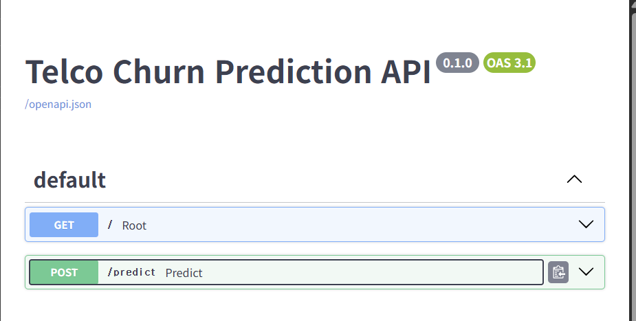
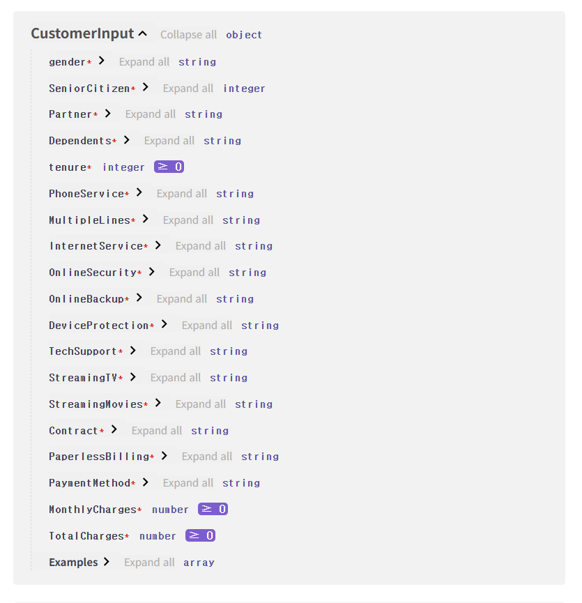
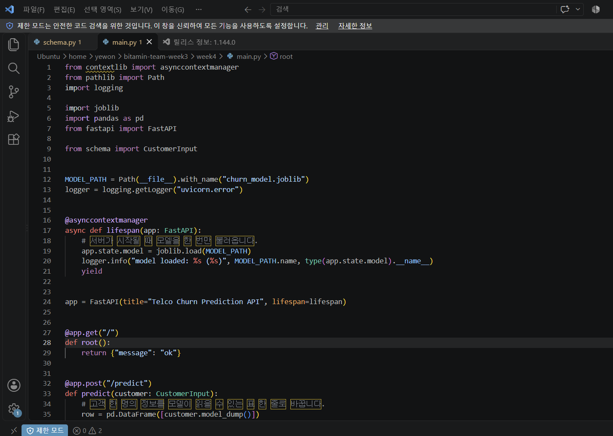
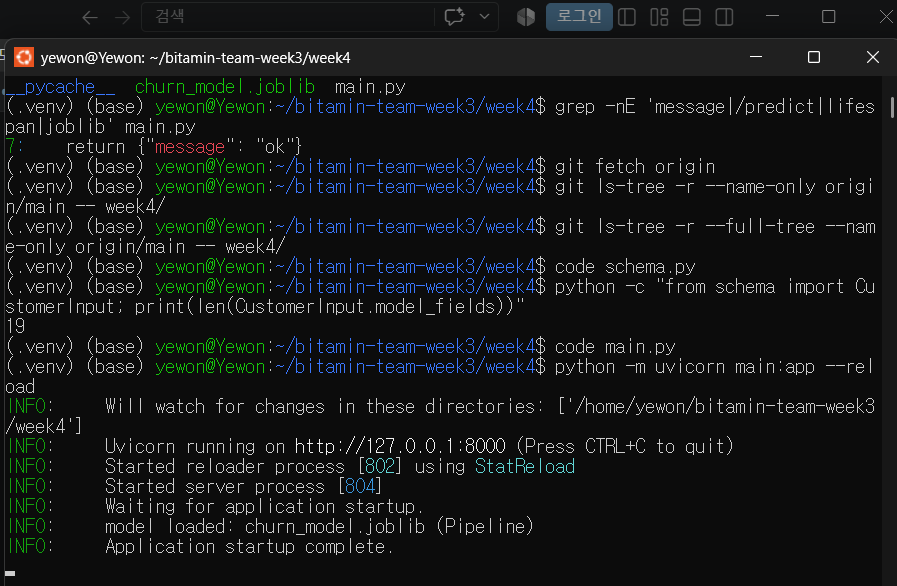
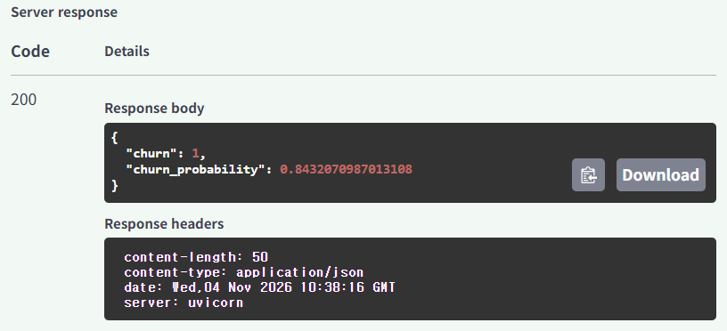

# 전예원 · 4주차 FastAPI 모델 서빙

3주차에 학습한 고객 이탈 예측 모델을 FastAPI에 연결했다. 같은 고객 정보를 Swagger와 Postman에서 각각 전송했을 때 두 요청 모두 HTTP 200과 동일한 예측 결과를 반환했다.

## 1. 서버 실행 및 Swagger 접속

가상환경에서 `python -m uvicorn main:app --reload`를 실행하고 `http://127.0.0.1:8000/docs`에 접속했다. Swagger에 상태 확인용 `GET /`와 예측용 `POST /predict`가 표시됐다.

## 2. 고객 입력 스키마

`CustomerInput`은 고객 정보 19개를 검증한다. 예를 들어 가입 기간인 `tenure`는 0 이상의 정수이고, 월 요금인 `MonthlyCharges`는 0 이상의 숫자다.

## 3. 모델 로드 및 예측 구현

서버 시작 시 `joblib.load`로 모델을 한 번 읽는다. 예측 요청이 들어오면 고객 한 명의 정보를 DataFrame 한 행으로 바꾸고, 모델의 예측값과 이탈 클래스의 확률을 반환한다. 기동 로그에서 모델이 Pipeline으로 로드됐음을 확인했다.

## 4. Swagger에서 예측 요청

예시 고객 정보를 보내 HTTP 200을 받았다. 모델은 이 고객을 이탈(`churn: 1`)로 분류했고, 이탈 확률은 약 84.32%였다.

## 5. Postman에서 동일 요청 확인

Postman에서 `POST http://127.0.0.1:8000/predict`를 선택하고, **Body → raw → JSON**에 Swagger와 같은 고객 정보를 넣어 전송했다.

| 실행 도구 | HTTP 상태 | churn | churn_probability |
| --- | --- | --- | --- |
| Swagger | 200 | 1 | 0.8432070987013108 |
| Postman | 200 OK | 1 | 0.8432070987013108 |
