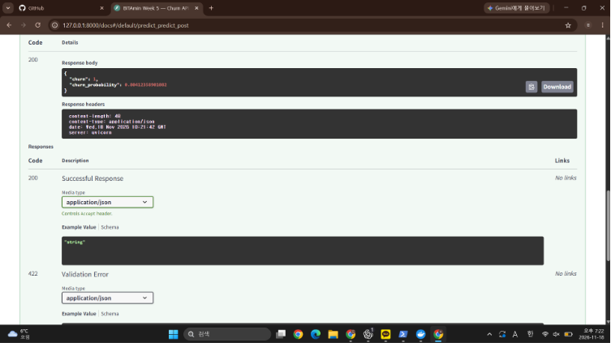
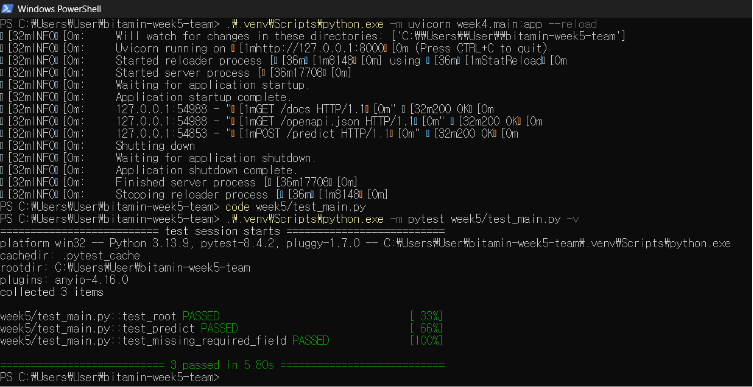
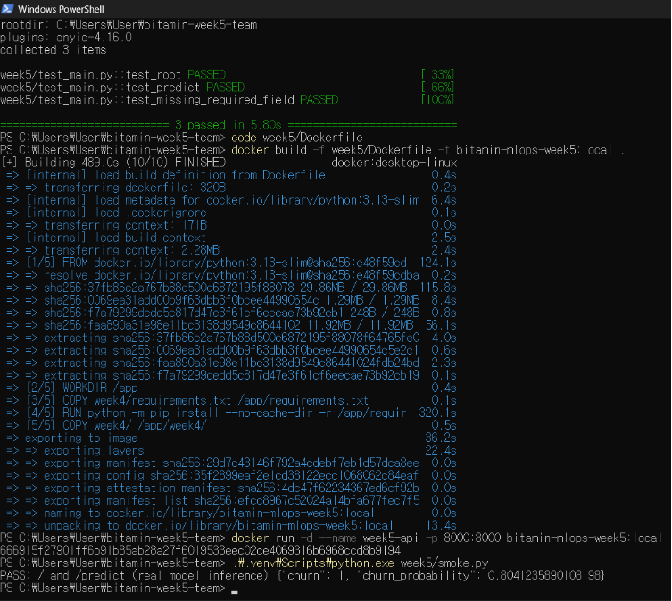
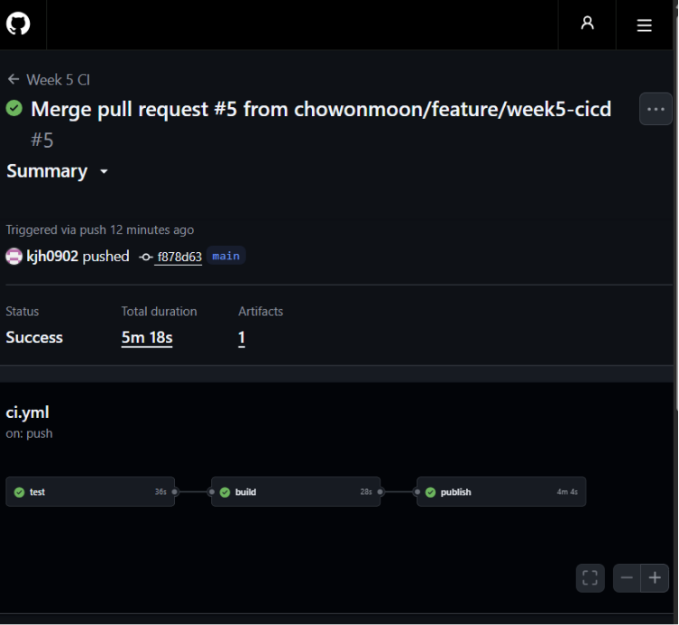
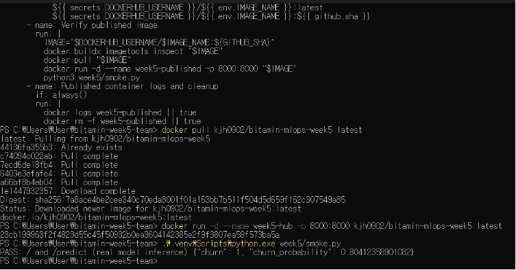

# 전예원 · 11월 18일 Week 5 실습 결과

- 조: 문제풀이 1조
- 제출자: 전예원
- 제출 브랜치: `예원1118`
- 검증한 main 커밋: `f878d63e4f40f0903afc1ef7c31544a42d04de6d`
- [Actions 성공 실행](https://github.com/chowonmoon/bitamin-mlops-1/actions/runs/44289011606)
- [Docker Hub 이미지 및 Tags](https://hub.docker.com/r/kjh0902/bitamin-mlops-week5/tags)
- 이미지: `kjh0902/bitamin-mlops-week5:latest`
- Digest: `sha256:7a8ace4be2cee340c70eda8001f01a163bb7b511f504d5d659f162c307549a85`

## CP1 · 실제 예측 API

Swagger의 POST `/predict`에서 HTTP 200, churn=1, churn_probability=0.80412358901082를 확인했습니다.

## CP2 · 자동 테스트

기본 응답, 정상 예측, tenure 누락 요청의 422 응답을 검사하는 세 테스트가 모두 통과했습니다 (`3 passed`).

## CP3 · Docker 컨테이너 실행

이미지 빌드를 완료하고 로컬 컨테이너에 smoke.py를 실행하여 실제 모델 예측 PASS를 확인했습니다.

## CP4 · GitHub Actions 자동 테스트와 빌드

조별 main 병합 실행에서 test와 build 성공을 확인했습니다. 아래 화면은 조별 공통 실행 결과입니다.

## CP5 · Docker Hub 업로드 및 다운로드 실행

위 Actions 실행의 publish가 성공했습니다. 개인 PC에서 `kjh0902/bitamin-mlops-week5:latest`를 pull하고 컨테이너로 실행한 뒤 smoke.py PASS를 확인했습니다.

Docker Hub Tags 화면 캡처는 이번에 제공한 5장에 포함되지 않았습니다. 이미지 링크는 위에 기록했습니다.

## 문제와 해결

공유 브랜치에 다른 변경이 먼저 올라와 push가 거절되었습니다. pull --rebase 후 test_main.py의 줄바꿈 차이로 발생한 충돌을 정리하고, 3 passed를 재확인한 뒤 rebase를 완료하여 push했습니다.
