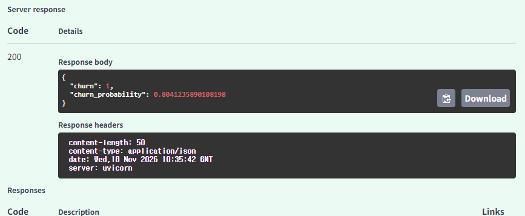
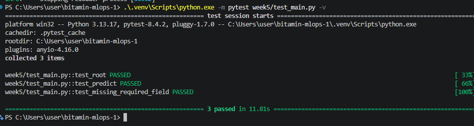
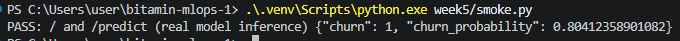
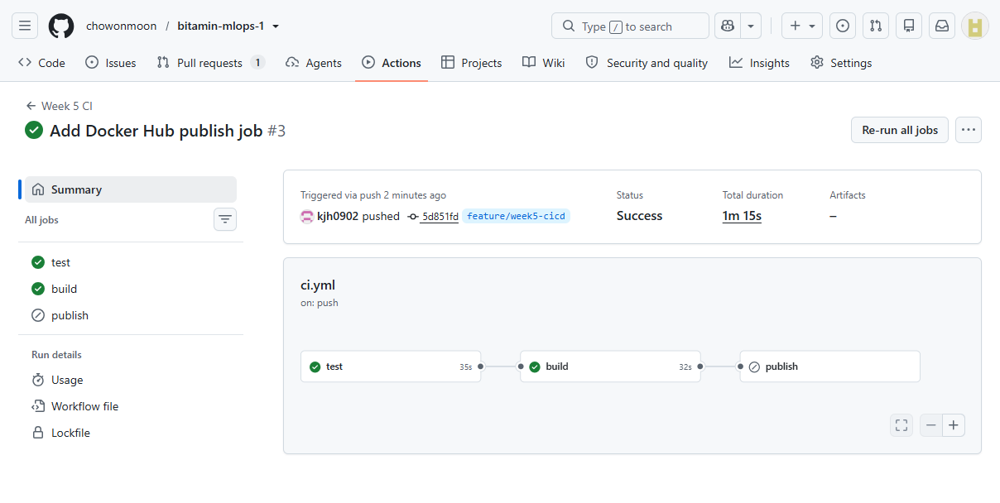
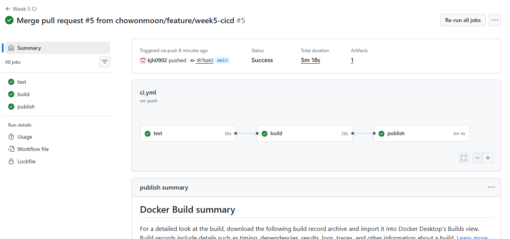
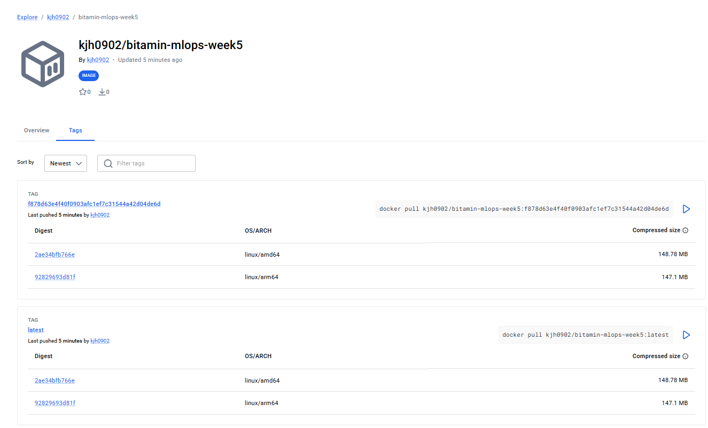
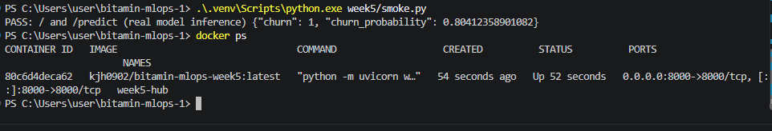

# Week 5 — 문초원 체크포인트 기록

Docker + GitHub Actions로 이탈 예측 API의 CI/CD 구축 (저장소 소유자)

## 결과 기록

- 참여자: 문초원 (저장소 소유자)
- 실행 환경: Windows, Python 3.13.17, Docker Desktop (Linux containers), PowerShell
- 제출 커밋: `f878d63` (PR #5 병합 커밋, main)
- Actions 성공 실행 링크
  - 작업 브랜치 `feature/week5-cicd` (test·build): https://github.com/chowonmoon/bitamin-mlops-1/actions/runs/44288614237
  - main (test·build·publish): https://github.com/chowonmoon/bitamin-mlops-1/actions/runs/44289011606
- Docker Hub 이미지 링크: https://hub.docker.com/r/kjh0902/bitamin-mlops-week5
- 이미지 태그 / digest
  - 태그: `latest`, `f878d63e4f40f0903afc1ef7c31544a42d04de6d`
  - linux/amd64 `2ae34bfb766e` · linux/arm64 `92829693d81f`

## 체크포인트

| CP | 내용 | 결과 |
| --- | --- | --- |
| CP1 | Swagger `POST /predict` | Code 200, `churn: 1`, `churn_probability: 0.804` |
| CP2 | API 테스트 3개 | `3 passed in 11.81s` |
| CP3 | 로컬 Docker 컨테이너 | `smoke.py` PASS (실제 모델 추론) |
| CP4 | push 시 자동 테스트·빌드 | test·build 성공, publish skipped (작업 브랜치라 정상) |
| CP5 | Docker Hub 자동 업로드·실행 | main에서 publish 성공, Hub에 태그 2개(amd64·arm64), pull한 이미지로 PASS |

### CP1 — Swagger 예측

### CP2 — pytest 3 passed

### CP3 — 로컬 컨테이너 smoke test

### CP4 — 작업 브랜치 Actions (test·build)

### CP5 — main publish 성공

### CP5 — Docker Hub Tags (latest + SHA, amd64·arm64)

### CP5 — Docker Hub 이미지 pull 후 실행
`docker ps`의 IMAGE가 `kjh0902/bitamin-mlops-week5:latest`인 컨테이너(`week5-hub`)로 smoke test 통과

## 문제와 해결

1. **VS Code가 WSL 원격 연결에서 멈춤**
   저장소가 WSL(Ubuntu) 안에 clone되어 있어 `Starting VS Code in WSL... Downloading server`에서 진행되지 않았다. Windows 경로(`C:\Users\user`)에 저장소를 새로 clone하고 PowerShell 기준으로 진행했다.
2. **`git pull`/`git push` 거부**
   팀원이 같은 파일(Dockerfile, test_main.py, ci.yml)을 먼저 push해 로컬 커밋과 충돌했다. `git fetch origin` 후 `git reset --hard origin/feature/week5-cicd`로 원격 버전에 맞췄다. 내용이 같은 정답 코드라 손실은 없었다.
3. **Secret 중복 등록 오류**
   팀원이 이미 `DOCKERHUB_TOKEN`·`DOCKERHUB_USERNAME`을 등록해 두었다. 토큰과 ID는 같은 Docker Hub 계정이어야 하므로 팀원 계정(`kjh0902`)으로 통일하고, 새로 발급한 개인 토큰은 사용하지 않았다.
